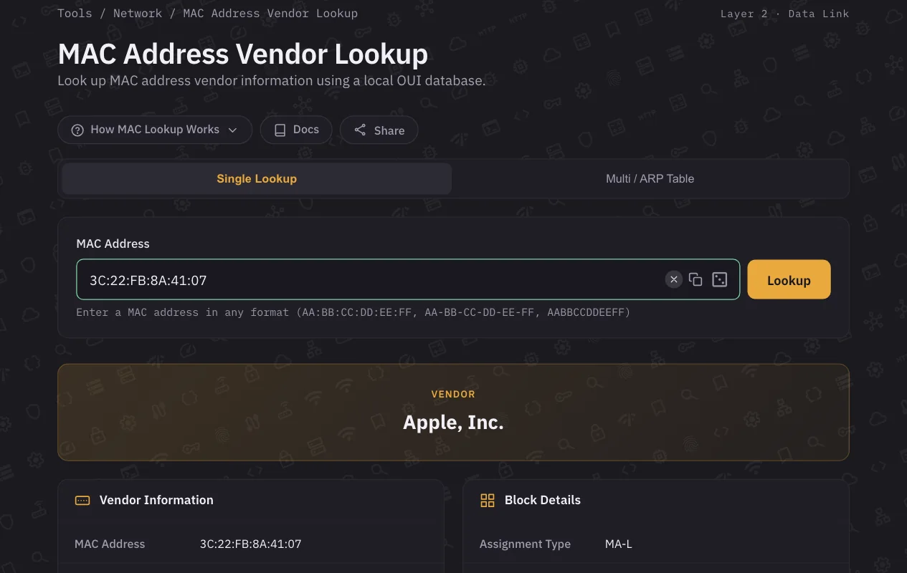

<p align="center">
<a href="https://troubleshooting.tools/lookup/mac/"></a>
</p>

<h1 align="center">MAC Address Vendor Lookup</h1>

<p align="center">Find the organisation behind a MAC address, an OUI or every entry of an ARP table.</p>

<p align="center"><a href="https://troubleshooting.tools/lookup/mac/"><b>Open the tool</b></a> &nbsp;·&nbsp; <a href="https://troubleshooting.tools/docs/mac-lookup">Documentation</a> &nbsp;·&nbsp; <a href="https://disisto.de/project-mac-lookup">Project page</a></p>

<p align="center"></p>

## Contents

- [Features](#features)
- [On the web page](#on-the-web-page)
- [Links you can share](#links-you-can-share)
- [Registry types and block sizes](#registry-types-and-block-sizes)
- [Why the most specific block wins](#why-the-most-specific-block-wins)
- [Special addresses](#special-addresses)
- [From the command line](#from-the-command-line)
- [Recipes](#recipes)
- [Privacy](#privacy)
- [Good to know](#good-to-know)

## Features

- Resolves full addresses as well as bare prefixes against a local copy of the public IEEE registries: MA-L, MA-M, MA-S, CID and IAB.
- Picks the most specific registered block, so small MA-M and MA-S assignments are named correctly and not hidden behind the large block around them.
- Shows the registered organisation, its filed address, the registry type, how many addresses the block holds and its first and last address.
- Any common notation works: colons, hyphens, Cisco-style dots, no separators, and the macOS form without leading zeros.
- A second tab takes a pasted ARP table or any mixed text and resolves every address it finds.
- Broadcast, multicast and locally administered addresses get an explanation with the standard behind them.
- An open API in JSON or plain text, for one address or a comma-separated list.

## On the web page

1. Open <https://troubleshooting.tools/lookup/mac/>.
2. On the **Single Lookup** tab, type an address such as `3C:22:FB:8A:41:07` and press **Lookup**.
3. For many devices at once, switch to **Multi / ARP Table**, paste the output of `arp -a` or `ip neigh` as it is and press **Lookup All**.

A single lookup shows these panels:

| Panel | What it shows |
|---|---|
| **Vendor Information** | the address as entered, vendor, matched OUI and the organisation's filed address |
| **Block Details** | assignment type (MA-L, MA-M, MA-S, CID or IAB), block size, range start and range end |
| **Organization Location** | the filed address on a map, loaded only after you agree to it |
| **Special MAC Address** | for broadcast, multicast and locally administered addresses: address type, standard, typical usage and why there is no vendor |

The multi tab answers with one table row per address found: MAC address, OUI, vendor and type. Duplicates are removed, every address is written as `XX:XX:XX:XX:XX:XX`, special addresses show their name instead of a vendor, and lines without an address are skipped.

## Links you can share

Every lookup has a stable address that opens straight on the result:

| Notation | Link |
|---|---|
| With colons | <https://troubleshooting.tools/lookup/mac/3C:22:FB:8A:41:07> |
| Without separators | <https://troubleshooting.tools/lookup/mac/70B3D5F2A123> |

Shared in a chat or a ticket, the preview already carries the result, for example *“3C:22:FB:8A:41:07 is registered to Apple, Inc. (MA-L), 3C:22:FB:00:00:00 to 3C:22:FB:FF:FF:FF.”*

**Search from the browser address bar.** Add a custom search engine in your browser with this URL and a short keyword such as `mac`:

```
https://troubleshooting.tools/lookup/mac/%s
```

Typing `mac 3C22FB8A4107` in the address bar then opens the lookup directly. Use the form without separators here, because browsers encode colons in search terms.

## Registry types and block sizes

The IEEE hands out MAC address space in blocks of three sizes. The size decides how many leading hex digits identify the owner:

| Type | Identified by | Addresses per block | Typical holder |
|---|---|---|---|
| MA-L | 6 hex digits | 16,777,216 | large manufacturers |
| MA-M | 7 hex digits | 1,048,576 | mid-sized manufacturers |
| MA-S | 9 hex digits | 4,096 | small series and special devices |
| IAB | 9 hex digits | 4,096 | the older form of MA-S |
| CID | 6 hex digits | 16,777,216 | company identifiers, handled like an MA-L block with start and end address |

That is why a bare prefix sometimes resolves and sometimes does not: six digits are enough for an MA-L block, but an MA-S assignment needs nine.

## Why the most specific block wins

An MA-S or MA-M block sits inside a larger block that the IEEE keeps for itself. The lookup therefore tries nine digits first, then seven, then six, and the first match names the real assignee.

If an address only reaches the IEEE's own parent block, the answer asks for more digits instead of naming the registry as the vendor:

```sh
curl -s https://api.troubleshooting.tools/v1/lookup/mac/json/70B3D5
```

```json
[{"mac":"70B3D5","error":"Vendor information incomplete. Please provide a full MAC address."}]
```

With the full address the same prefix resolves to the small block and its owner:

```sh
curl -s https://api.troubleshooting.tools/v1/lookup/mac/json/70B3D5F2A123 | jq .
```

```json
[
  {
    "mac": "70B3D5F2A123",
    "oui": "70B3D5F2A",
    "vendor": "WIBOND Informationssysteme GmbH",
    "organization_address": "Neustädter Strasse 19 Parkstein Bayern DE 92711",
    "assignment_type": "MA-S",
    "block_size": 4096,
    "start_address": "70:B3:D5:F2:A0:00",
    "end_address": "70:B3:D5:F2:AF:FF"
  }
]
```

Blocks no longer in the IEEE files are left out of the matching.

## Special addresses

Some addresses are not assigned to a manufacturer at all. On the web page they get a **Special MAC Address** panel instead of a vendor:

| Address | Type | Standard | Typical use |
|---|---|---|---|
| `FF:FF:FF:FF:FF:FF` | Broadcast | IEEE 802.3 | ARP requests, DHCP discovery |
| `01:00:5E:7F:00:01` | IPv4 multicast | RFC 7042 | mDNS, IGMP, routing protocols; the lower 23 bits carry the group |
| `33:33:00:00:00:FB` | IPv6 multicast | RFC 2464 | neighbour discovery, multicast listener discovery |
| `02:42:AC:11:00:02` | Locally administered | IEEE 802 | privacy protection, virtual machines, software-defined networking |

An address is locally administered when the second-lowest bit of the first octet is set. Through the API these addresses come back with `OUI not found for the provided MAC address.`; the explanation is part of the web page.

Not every unusual block is special: `00:00:5E:00:01:0A`, a VRRP virtual router address, belongs to a regular MA-L block registered to IANA and resolves like any other.

## From the command line

The API lives at `https://api.troubleshooting.tools/v1`, needs no key and allows requests from any origin:

```
/lookup/mac/json/{mac}     JSON array with the full record
/lookup/mac/{mac}          plain text with the vendor name
```

Both take one address or several separated by commas, in any notation.

| Field | Meaning |
|---|---|
| `mac` | the address exactly as sent |
| `oui` | the matched prefix: 6, 7 or 9 hex digits |
| `vendor` | registered organisation |
| `organization_address` | the filed address, copied as registered |
| `assignment_type` | MA-L, MA-M, MA-S, CID or IAB |
| `block_size`, `start_address`, `end_address` | size and boundaries of the block |
| `error` | present instead of the fields above when an address cannot be resolved |

Each address that cannot be resolved gets its own error entry in the array; the request itself still answers with HTTP 200:

| Message | Meaning |
|---|---|
| `Invalid MAC address format.` | the input is not a MAC address |
| `OUI not found for the provided MAC address.` | well-formed, but in no registered block: special or randomised addresses |
| `Vendor information incomplete. Please provide a full MAC address.` | only the IEEE parent block matched; send more digits |

Every field and message is also described in the [documentation](https://troubleshooting.tools/docs/mac-lookup).

## Recipes

**Vendor name only, for a quick check**

```sh
curl -s https://api.troubleshooting.tools/v1/lookup/mac/3C:22:FB:8A:41:07
# Apple, Inc.
```

**Several addresses in one request**

```sh
curl -s "https://api.troubleshooting.tools/v1/lookup/mac/json/001A113F6B20,3c-22-fb-8a-41-07,02-42-AC-11-00-02" \
  | jq -r '.[] | "\(.mac)\t\(.vendor // .error)"'
# 001A113F6B20        Google, Inc.
# 3c-22-fb-8a-41-07   Apple, Inc.
# 02-42-AC-11-00-02   OUI not found for the provided MAC address.
```

**Resolve your ARP table**

The macOS form without leading zeros (`0:1a:11:…`) is accepted as it is:

```sh
MACS=$(arp -a \
  | grep -oE '([0-9a-fA-F]{1,2}[:-]){5}[0-9a-fA-F]{1,2}' \
  | paste -sd, -)
curl -s "https://api.troubleshooting.tools/v1/lookup/mac/$MACS"
# 3c:22:fb:8a:41:7: Apple, Inc.
# 0:1a:11:3f:6b:20: Google, Inc.
```

With exactly one address in the table, the plain-text answer is just the vendor name, without the prefix.

**Block boundaries for an allow list**

```sh
curl -s https://api.troubleshooting.tools/v1/lookup/mac/json/70B3D5F2A123 \
  | jq -r '.[0] | "\(.vendor): \(.start_address) – \(.end_address)"'
# WIBOND Informationssysteme GmbH: 70:B3:D5:F2:A0:00 – 70:B3:D5:F2:AF:FF
```

**Spot locally administered addresses before asking**

```sh
mac=02:42:AC:11:00:02
[ $(( 0x${mac:0:2} & 2 )) -ne 0 ] && echo "$mac is locally administered"
```

Send a whole table as one comma-separated request rather than one request per address.

## Privacy

- No account, no sign-up, no key.
- Only the public IEEE registry is read.
- A MAC address identifies a network interface, so treat lists you paste as identifying data.
- The map of the registered address is the only third-party content and loads only after you agree to it.

## Good to know

- Phones and laptops often use a random MAC address on Wi-Fi. When no vendor is found, that is the usual reason.
- The filed organisation address is copied from the registry as it is; its formatting varies from entry to entry.
- The JSON answer is an array, also for a single address.
- The service is reached over IPv4.

---

<sub>Part of <a href="https://troubleshooting.tools">troubleshooting.tools</a>.</sub>
